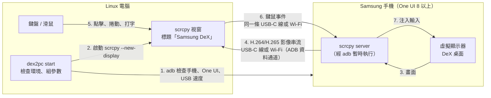

# dex2pc


**透過 USB-C 線或 Wi-Fi，把 Samsung DeX 變成 Linux 電腦上的一個視窗，並直接用電腦的鍵盤滑鼠操作。**

> 目前狀態：`start` 可一鍵開啟 DeX 視窗，`doctor` 可檢查電腦端工具、手機連線、USB 速度與 One UI 版本，`config` 可查看設定，`start --watch` 可在斷線後自動重連，`install-desktop` 可建立應用程式選單捷徑；
> Wi-Fi 支援新增 `pair`、`connect` 與 `start --wifi`，無線功能尚待實機驗收。
> 既有 USB 功能都已在實機（Galaxy S23、One UI 8.5、scrcpy 5.0.1）**驗收通過**，rpm／deb 安裝包附的選單捷徑也已在實體主機確認，細節見「[實機驗收清單](#實機驗收清單)」。
> 版號只寫在 `Cargo.toml`，用 `dex2pc --version` 查看。

## 運作方式



1. **dex2pc** 使用 USB adb，或先連接 Wi-Fi adb，再確認手機已授權、是 One UI 8 以上；USB 模式另外診斷連線速度
2. 檢查通過後啟動 **scrcpy**，在手機上建立**虛擬顯示器**，DeX 桌面跑在上面
3. 手機把畫面壓成**影片串流**，經 USB-C 線或 Wi-Fi 的 ADB 資料通道傳回電腦，顯示成一個視窗
4. 在視窗裡的**鍵盤滑鼠操作**由 scrcpy 送回手機，所以用電腦的鍵鼠就能直接操作 DeX
5. **關閉視窗**就結束；`--watch` 時 USB 等裝置接回，Wi-Fi 則重試 `adb connect`，連線恢復後自動重新開啟

## 需求

- **電腦**：Linux，安裝包支援 **Fedora**（rpm）、**Debian 13 / Ubuntu 26.04 以上**（deb）；其他發行版用 `cargo install`
- **手機**：Samsung，**One UI 8 以上**（DeX 改建在 Android 16 Desktop Mode 上，才能跑在虛擬顯示器）
- **adb**：Fedora `sudo dnf install android-tools`；Debian / Ubuntu `sudo apt install adb`（用安裝包時會自動裝）
- **scrcpy 3.2 以上**（需要 `--new-display` 與 `--display-ime-policy`）：Fedora `sudo dnf copr enable zeno/scrcpy && sudo dnf install scrcpy`；Debian / Ubuntu 見下方 deb 安裝
- USB 模式需要**支援資料傳輸的 USB-C 線**（有些線只能充電，接上後 `adb devices` 會看不到手機）；Wi-Fi 模式需要手機與電腦之間可互通的網路
- 從原始碼建置才需要 Rust（cargo）；用安裝包不需要

## 安裝

GUI 需要系統中文字型；rpm／deb 會強制相依並自動安裝。自行編譯時，Fedora 請執行 `sudo dnf install google-noto-sans-cjk-fonts`，Debian／Ubuntu 請執行 `sudo apt install fonts-noto-cjk`。程式不內附字型，啟動時先透過 fontconfig 尋找繁中字型，再檢查常見路徑；找不到時仍可啟動，並顯示英文安裝提示。

三種方式擇一：**rpm 安裝包**（Fedora x86_64）、**deb 安裝包**（Debian 13 / Ubuntu 26.04 以上，amd64），或 **`cargo install`**（從原始碼，其他發行版）。

### 方式一：rpm 安裝包（Fedora x86_64）

rpm **只支援 Fedora（x86_64）**。套件強制相依 `android-tools` 與 `scrcpy >= 3.2`，而 Fedora 官方倉庫沒有夠新的 scrcpy，所以要**先啟用 COPR**：

```bash
sudo dnf copr enable zeno/scrcpy
sudo dnf install ./dex2pc-*.rpm
```

- **沒有啟用 COPR 就安裝會失敗**：dnf 會回報找不到 `scrcpy >= 3.2`，先執行上面第一行再重試
- rpm 從 [GitHub Releases](../../releases) 下載，旁邊的 `.sha256` 檔可用 `sha256sum -c dex2pc-*.rpm.sha256` 檢查下載有沒有損壞
- **正式安裝包只來自 MINOR 以上的版本（`vX.Y.0`）的 Release**；PATCH 版（`X.Y.Z`，Z 不為 0）不發佈 Release，只有 CI 每次建置時上傳的 artifact（GitHub Actions 該次執行頁面的 Artifacts），供測試用
- 與 `cargo install` 的差別：rpm 會把應用程式選單的**捷徑一併裝好**（`/usr/share/applications/dex2pc.desktop`），**不必再跑 `dex2pc install-desktop`**；dex2pc 裝在 `/usr/bin/dex2pc`，不需要 Rust
- 移除：

```bash
sudo dnf remove dex2pc
```

**從原始碼自己建 rpm**（例如要裝 PATCH 版，或修改過程式碼）：

```bash
sudo dnf install rpm-build cargo rust desktop-file-utils git tar
packaging/build-rpm.sh                 # 產出 dist/dex2pc-<版號>-1.<dist>.x86_64.rpm
sudo dnf copr enable zeno/scrcpy
sudo dnf install ./dist/dex2pc-*.rpm
```

打包的細節見 [`packaging/README.md`](packaging/README.md)。

### 方式二：deb 安裝包（Debian 13 / Ubuntu 26.04 以上，amd64）

deb **只支援 Debian 13（trixie）與 Ubuntu 26.04 以上，amd64**。套件強制相依 `android-tools-adb`（由 `adb` 套件提供）與 `scrcpy (>= 3.2)`。

**Ubuntu 26.04**：倉庫的 scrcpy 是 3.3.4，夠新，直接安裝：

```bash
sudo apt install ./dex2pc_*.deb
```

**Debian 13**：倉庫**沒有 scrcpy**（trixie、trixie-backports、testing、unstable 都沒有，2026-10 查證），直接 `apt install` 會因為找不到 `scrcpy (>= 3.2)` 而失敗。先裝 scrcpy 官方的靜態版，再建一個「佔位」套件告訴 apt scrcpy 已經裝好：

```bash
# 1. 官方靜態版（版本號換成 https://github.com/Genymobile/scrcpy/releases/latest 的最新版）
#    每個版本解壓到 /opt/scrcpy 底下自己的目錄，/usr/local/bin/scrcpy 連結指向要用的那一版
wget https://github.com/Genymobile/scrcpy/releases/download/v5.0.1/scrcpy-linux-x86_64-v5.0.1.tar.gz
sudo mkdir -p /opt/scrcpy
sudo tar xf scrcpy-linux-x86_64-v5.0.1.tar.gz -C /opt/scrcpy
sudo ln -sf /opt/scrcpy/scrcpy-linux-x86_64-v5.0.1/scrcpy /usr/local/bin/scrcpy
scrcpy --version     # 第一行要是 scrcpy 5.0.1，確認後才做第 2 步

# 2. 佔位套件：只用來滿足 dex2pc 的 Depends，裡面沒有任何檔案；Version 填上面確認到的版本
sudo apt install equivs
printf 'Package: scrcpy\nVersion: 5.0.1\nMaintainer: local <root@localhost>\nArchitecture: all\nDescription: placeholder for scrcpy installed under /opt/scrcpy\n' > scrcpy-placeholder
equivs-build scrcpy-placeholder
sudo apt install ./scrcpy_5.0.1_all.deb

# 3. 安裝 dex2pc
sudo apt install ./dex2pc_*.deb
```

- 以上步驟已在 Debian 13 容器實際跑過：`dex2pc doctor` 會列出 `scrcpy：5.0.1`
- **更新 scrcpy**：把第 1、2 步的 `5.0.1` 全部換成新版號重做一次。新版會解壓到自己的目錄，`ln -sf` 把連結改指向新版；
  `scrcpy --version` 確認是新版後再重建佔位套件，`apt install` 會把佔位套件升級成新版號（不用先移除 dex2pc）。
  舊版目錄確認不用後可刪：`sudo rm -rf /opt/scrcpy/scrcpy-linux-x86_64-v<舊版號>`
- 其他 scrcpy 低於 3.2 的發行版處理方式相同

**共通說明**：

- deb 從 [GitHub Releases](../../releases) 下載，`.sha256` 檔的用法同 rpm；**PATCH 版不發佈 Release**，只有 CI 的 artifact
- 和 rpm 一樣附好應用程式選單的捷徑，不必再跑 `dex2pc install-desktop`
- **`dex2pc doctor` 的安裝提示目前只列 Fedora 的 `dnf` 指令**；Debian / Ubuntu 使用者看到時請照這一段 README 安裝，不要照提示執行
- 移除：

```bash
sudo apt remove dex2pc
```

**從原始碼自己建 deb**：

```bash
sudo apt install cargo git gzip binutils dpkg
packaging/build-deb.sh                 # 產出 dist/dex2pc_<版號>_amd64.deb，只能在 x86_64 主機上建
sudo apt install ./dist/dex2pc_*.deb
```

### 方式三：`cargo install`

```bash
cargo install --path .     # 編譯並安裝到 ~/.cargo/bin/dex2pc
dex2pc install-desktop     # 選用：在應用程式選單加入「Samsung DeX」捷徑
```

`~/.cargo/bin` 要在 `PATH` 裡（用 rustup 安裝 Rust 時預設會加）。adb 與 scrcpy 要自己裝，見上面的「需求」。

**應用程式選單捷徑**（`cargo install` 才需要；rpm 已經附好）：`dex2pc install-desktop` 會建立 `~/.local/share/applications/dex2pc.desktop`（依 `XDG_DATA_HOME`），點它開啟 `dex2pc gui`。

- 捷徑記錄的是**執行指令當下的 dex2pc 絕對路徑**，所以請在 `cargo install` 之後用 `dex2pc install-desktop` 建立，不要用 `cargo run`（會指向 `target/` 裡的檔案）
- 重複執行只會覆寫同一個檔案；移除用 **`dex2pc install-desktop --uninstall`**
- 捷徑開啟圖形設定與工具列，可查看錯誤、開啟或停止投影；CLI 仍可獨立使用

## 快速開始

1. 手機開啟 **USB 偵錯**：設定 → 關於手機 → 軟體資訊 → 連點「版本號碼」7 次開啟開發人員選項，再到 設定 → 開發人員選項 → 開啟「USB 偵錯」
2. 用**支援資料傳輸的 USB-C 線**接上電腦，手機跳出「允許 USB 偵錯？」時按**允許**
3. 執行：

```bash
dex2pc start
```

（用 rpm 或 `cargo install` 安裝後都是直接執行 `dex2pc`；還沒安裝、在原始碼目錄裡試用時，把 `dex2pc` 換成 `cargo run --release --`，見「[建置與執行](#建置與執行)」。）

`start` 會先做和 `doctor` 一樣的檢查，全部通過才以虛擬顯示器開啟 **Samsung DeX** 視窗；直接用電腦的鍵盤滑鼠操作，**關閉視窗即結束**。
有問題時照畫面上的訊息處理，或先跑 `dex2pc doctor` 看完整檢查結果。

```bash
dex2pc start --dry-run                     # 只印出會執行的 scrcpy 指令，不連手機
dex2pc start --resolution 2560x1440 --video-bit-rate 16M   # 臨時覆寫設定檔
dex2pc start --watch                       # 拔線或斷線後，手機接回來自動重新開啟視窗
```

**`--watch` 自動重連**：scrcpy 因手機斷線結束時，dex2pc 會等手機重新接上，再自動開啟視窗。

- **關閉視窗**或按 **Ctrl+C** 就結束，不會重連
- 斷線後**連續 5 次**重新啟動失敗就放棄，每次失敗後等 2 秒再試；重新連上一次就重新計數
- 第一次啟動就失敗時**不重試**，因為通常是設定或環境問題，重試也不會好

### 手機端需要另外設定嗎？

**不需要。** 只要開啟 USB 偵錯並允許這台電腦，dex2pc 不會改任何 `adb settings`。

已在實機確認（2026-10-10）：**Galaxy S23（SM-S9180）、One UI 8.5（Android 16）、scrcpy 5.0.1**，
`dex2pc start` 建立的 1920x1080/160 虛擬顯示器上直接跑起 DeX 的桌面
（`com.sec.android.app.launcher/com.honeyspace.dexservice.SecondaryLauncher`，有桌面圖示與工作列），
scrcpy 結束後虛擬顯示器也跟著移除。

> ⚠️ 其他機型若開出的視窗是空白或只有一般手機畫面、不是 DeX，
> 請回報手機型號與 One UI 版本，以及 `adb shell settings list global | grep -i -E 'desktop|freeform'` 的輸出。

## 圖形介面與工具列

安裝 rpm／deb 後，從選單點「Samsung DeX」，或執行：

```bash
dex2pc gui
```

首次開啟會顯示設定精靈：檢查 adb／scrcpy（缺少時可複製安裝指令），選 USB 或 Wi-Fi，設定畫質並儲存。USB 模式每兩秒偵測手機；看到未授權提示時，請在手機按「允許 USB 偵錯」。Wi-Fi 建議先接 USB 按「切換到 Wi-Fi」，進階選項也可輸入連線 IP:埠，或配對 IP:埠與六位配對碼；配對埠與連線埠通常不同。配對碼不寫入設定或日誌。

「開啟 DeX」一律使用 watch 模式，畫面顯示連線狀態與訊息；「停止」會終止 scrcpy。工具列選單可開啟／停止、切換 USB／Wi-Fi、選畫質、從 USB 切換 Wi-Fi、開啟設定視窗及結束。選單變更立即儲存，下一次啟動投影生效。

設定沿用 `config.toml`，新增 `mode = "usb"` 或 `"wifi"`，以及 `quality = "high"`（16M）、`"balanced"`（8M，預設）、`"low"`（4M）。這兩個欄位只控制 GUI；CLI 仍沿用自己的參數與 `video_bit_rate`。格式錯誤會顯示設定路徑與欄位，修正後重新開啟。

設定完成後，啟動只顯示工具列；關閉設定視窗仍常駐，請從選單按「結束」。再次啟動只會顯示既有視窗；單一實例透過 `$XDG_RUNTIME_DIR/dex2pc/gui.sock` 溝通，未設定 runtime 目錄時使用設定目錄下的 runtime 子目錄。沒有 StatusNotifier 工具列支援時會退回純視窗，關窗即停止並退出。

**GNOME** 需要 AppIndicator 擴充套件。Fedora：

```bash
sudo dnf install gnome-shell-extension-appindicator
gnome-extensions enable appindicatorsupport@rgcjonas.gmail.com
```

Ubuntu／Debian GNOME：

```bash
sudo apt install gnome-shell-extension-appindicator
gnome-extensions enable appindicatorsupport@rgcjonas.gmail.com
```

安裝並啟用後請**登出再登入**。KDE Plasma 通常已支援 StatusNotifierItem。圖示為專案原創，沒有 Samsung 商標。套件會安裝 OpenGL、X11／Wayland 與中文字型依賴；自行編譯需 Rust 1.88 以上，`cargo install` 使用者亦需安裝這些執行期套件及 Noto CJK 字型。

## 無線投影

Wi-Fi 模式仍是 **adb → 環境檢查 → scrcpy --new-display**。手機不會主動搜尋到電腦；這不是 Samsung 原生 Wireless DeX／Miracast，請在電腦終端執行指令。

**建議先從 USB 切換**，可跳過無線配對。先讓手機與電腦連上可互通的 Wi-Fi 網路，接上 USB 並完成 USB 偵錯授權，再切換到 TCP 5555（需信任目前網路）：

```bash
dex2pc connect
# 多台 USB 手機時：dex2pc connect --serial R5CW1234ABC
# 成功後可拔除 USB 線
dex2pc start --wifi
```

切換時先讀取手機 wlan0 的 IP，再執行 `adb tcpip 5555`；這個指令會重啟手機 adbd，所以連線最多嘗試三次，失敗間隔一秒。讀不到 IP 時不切換，請先確認手機 Wi-Fi 已連線。`dex2pc connect IP:PORT` 與 `start --wifi` 仍只嘗試一次初始連線。

若不能接 USB，也可以使用手機的無線偵錯配對：

1. 在手機「設定 → 開發人員選項」開啟「無線偵錯」。
2. 點「使用配對碼配對裝置」，把畫面的配對 IP 與埠填入 `pair`；配對碼由 adb 互動詢問。
3. 回到無線偵錯主畫面，把「IP 位址與通訊埠」填入 `connect`。**連線埠與配對埠通常不同**。

```bash
dex2pc pair 192.168.1.20:37001
dex2pc connect 192.168.1.20:39501
dex2pc start --wifi
```

配對失敗時，請重新開啟手機配對視窗，使用**新的配對碼與埠號**，並執行 `adb kill-server` 後重試。Fedora／發行版 adb 有已知配對失敗，例如 `protocol fault (couldn't read status message)`；可改用 [Google 官方 platform-tools](https://developer.android.com/tools/releases/platform-tools)，確認 PATH 使用該版本的 adb；也可接 USB 執行 `dex2pc connect` 跳過配對。

成功連線會把 `wifi_address` 存到設定檔，保留其他欄位（不保留註解）。位址只接受 IPv4 或 ASCII DNS 主機名加十進位埠號 1–65535，例如 `phone.local:5555`；不接受 IPv6、空白、底線或以連字號開頭／結尾的主機名標籤。

手動指定地址會覆蓋此次啟動使用的設定值；`--wifi` 與 `--serial` 互斥。`--dry-run` 不執行任何外部指令，僅印出含無線序號的 scrcpy 指令：

```bash
dex2pc start --wifi 192.168.1.20:5555 --dry-run
dex2pc start --wifi --watch
dex2pc start --wifi --video-bit-rate 4M
```

Wi-Fi 斷線約在 15–20 秒內偵測到；加上 `--watch` 會關閉凍結的視窗並嘗試重新連線。

Wi-Fi 較慢時可降低 `--video-bit-rate`。`--watch` 斷線後改用 `adb connect`，每次失敗間隔 2 秒，連續 5 次失敗放棄；按 Ctrl+C 結束。手機重新連網、重開機或重新開啟無線偵錯後，IP／埠可能改變，請重新執行 `connect IP:PORT`。

## 建置與執行

以下是**開發用**：在原始碼目錄裡用 `cargo run` 直接執行（已安裝的使用者把 `cargo run --` 換成 `dex2pc` 即可，不需要 Rust）。

```bash
cargo build --release
cargo run -- --help
cargo run -- --version
cargo run -- doctor     # 檢查 adb、scrcpy 是否就緒，手機是否已連接並授權、USB 速度、是否為 One UI 8 以上
cargo run -- doctor --serial R5CW1234ABC   # 連了多台手機時指定其中一台
cargo run -- config     # 顯示設定檔位置與實際生效的設定
cargo run -- config --path   # 只印設定檔位置
cargo run -- config --audio  # 預覽覆寫後的設定（設定檔 audio = false 時重新開啟音訊）
```

## 設定檔

位置：**`$XDG_CONFIG_HOME/dex2pc/config.toml`**（沒設 `XDG_CONFIG_HOME` 時是 `~/.config/dex2pc/config.toml`）。
檔案不存在就用內建預設值；每個欄位都可省略，CLI 參數（例如 `--resolution 3840x2160`）會覆寫設定檔。
音訊可用 `--audio` / `--no-audio` 雙向覆寫設定檔的 `audio`；兩個都給時以**最後一個**為準。

```toml
resolution = "1920x1080"   # 虛擬顯示器解析度
dpi = 160                  # 數字越大介面越大
video_bit_rate = "16M"     # 省略時用 scrcpy 預設（8M）；小字模糊時調高
audio = true               # false 時不轉送手機音訊
keyboard = "uhid"          # sdk、uhid、aoa、disabled；省略時用 uhid（sdk 在 DeX 上打不出字）
mouse = "sdk"              # 同上；省略時用 scrcpy 預設
window_title = "Samsung DeX"
```

欄位名稱打錯或型別不對時，dex2pc 會指出檔案路徑與欄位並結束，不會默默忽略。

開發時的檢查指令：

```bash
cargo fmt --check && cargo clippy --all-targets -- -D warnings && cargo test
```

**進版**：版號只改 `Cargo.toml` 的 `version`，README 的版本 badge **不要手改**，用下面的指令重新產生（忘了跑時 `cargo test` 會失敗並提示）：

```bash
cargo run --example sync_version_badge
```

## 實機驗收清單

以下項目**只能在實機上確認**，自動測試都是用假的 adb / scrcpy 輸出，沒有驗證過。試用後請回報哪些可以、哪些不行：

- [x] `dex2pc doctor` 正確列出手機型號、One UI 版本、USB 速度（Galaxy S23、One UI 8.5，2026-10-10）
- [x] `dex2pc start` 開出的虛擬顯示器是 **DeX 桌面**（同上，以 `adb screencap` 確認畫面內容）
- [x] **滑鼠**：點擊、右鍵、拖曳、滾輪捲動（2026-10-10；右鍵會傳給手機，**Shift+右鍵**是返回）
- [x] **鍵盤**：英文輸入、快捷鍵、**中文輸入**（用電腦的輸入法打字能否送進手機）（2026-10-10）
- [x] **剪貼簿**：電腦與手機之間複製貼上（2026-10-10）
- [x] **音訊**：手機的聲音從電腦播出（2026-10-10）；`--no-audio` 時不播
- [x] **拔線重連**：`dex2pc start --watch` 時拔掉再接回 USB 線，視窗會自動重新開啟（2026-10-10）
- [x] **Ctrl+C**：在執行 `dex2pc start --watch` 的終端機按 Ctrl+C，程式結束、視窗關閉、不再重連（2026-10-10）
- [x] **小字清晰度與操作延遲**：預設位元率下沒有問題（2026-10-10）；小字模糊時可用 `--video-bit-rate 16M`（或更高）
- [x] 應用程式選單的「Samsung DeX」捷徑能開啟視窗（2026-10-11，安裝包附的捷徑）

**安裝包**：以下每一項在 **Fedora（rpm）**、**Debian 13（deb）**、**Ubuntu 26.04（deb）** 的實體主機上各做一次，使用者已確認全部通過（2026-10-11，0.3.0）：

- [x] **安裝**：照上方「安裝」的指令裝好，`dex2pc --version` 印出版號
- [x] **選單捷徑**：不跑 `dex2pc install-desktop`，應用程式選單就出現「Samsung DeX」（可能要重新登入才會出現）
- [x] **點擊開出視窗**：接上手機後點選單的「Samsung DeX」，開出 DeX 視窗，鍵盤滑鼠可以操作
- [x] **移除**：`sudo dnf remove dex2pc` / `sudo apt remove dex2pc` 後，選單的「Samsung DeX」消失，`dex2pc` 指令也找不到

無線功能尚待實機驗收：

- [ ] 無線偵錯配對：`dex2pc pair IP:PORT` 能互動輸入配對碼
- [ ] USB 切換：`dex2pc connect` 能取得手機 Wi-Fi IP 並儲存連線位址
- [ ] 拔除 USB 後 `dex2pc start --wifi` 開出 DeX，鍵盤滑鼠可操作
- [ ] Wi-Fi 斷線後 `--watch` 自動重連；Ctrl+C 可停止

## 頻寬：USB 2.0 就夠嗎？

**夠。** 畫面是壓縮後的影片串流，不是原始畫面：

| 項目 | 需要 / 提供 |
|------|-------------|
| 不壓縮 1080p60 | 約 3 Gbps（所以一定要壓縮） |
| scrcpy 壓縮後影像（H.264/H.265） | 預設 **8 Mbps**，高畫質約 **16–20 Mbps** |
| 音訊 + 鍵鼠事件 | 不到 0.2 Mbps |
| USB 2.0 | 480 Mbps |

- 壓縮後的串流只用掉 USB 2.0 的一小部分，**瓶頸不在線材**，而在手機的硬體編碼器（解析度上限、發熱）與編解碼延遲（通常幾十毫秒）
- 小字模糊是壓縮造成的，**調高位元率**（`--video-bit-rate 16M`）通常就能改善
- `dex2pc doctor` 會顯示實際協商到的 USB 速度；低於 480 Mbps 才代表線材或 hub 有問題

## 原理：為什麼不是直接走 DisplayPort？

- 手機接外接螢幕時走的是 USB-C 的 **DisplayPort Alt Mode**，手機是**訊號來源**。
  電腦的 USB-C 孔同樣只會**輸出**影像，沒有接收端，兩個來源對接不會有畫面。
- 所以畫面改走 USB 的**資料通道**：手機把畫面壓成 H.264/H.265 影片串流，經 ADB 傳到電腦解碼成視窗，
  鍵鼠事件再經同一條線傳回手機。壓縮後只需約 8–20 Mbps，USB 2.0 就足夠。
  `doctor` 會顯示手機實際協商到的 USB 速度，低於 480 Mbps（USB 2.0）時警告可能是線材或 hub 的問題。

### scrcpy 是什麼？

[scrcpy](https://github.com/Genymobile/scrcpy) 是 Genymobile 開發的**開源免費**工具（Apache 2.0）。
它經 ADB 在手機上暫時跑一個小程式，負責畫面串流、在電腦上開視窗、轉送鍵鼠事件；
**不需要在手機裝 App，也不需要 root**。scrcpy 3.0 起的 `--new-display` 能在手機上建立虛擬顯示器（dex2pc 另外用到 3.2 起才有的 `--display-ime-policy`，所以要求 3.2 以上），One UI 8 起 DeX 會直接跑在上面（已在實機確認，見上方「手機端需要另外設定嗎？」）。

dex2pc **不重寫**這些部分，只負責檢查環境、組好 scrcpy 參數、一鍵啟動。

### GUI／工具列實機驗收（0.3.3）

- [ ] GUI USB：未授權提示、自動重試、授權後開啟 DeX 與鍵鼠操作
- [ ] GUI Wi-Fi：USB 切換、手動位址、配對碼，無線開啟 DeX
- [ ] 停止可關閉 scrcpy；結束可停止並退出
- [ ] 重開程式記住連線方式、畫質、Wi-Fi 位址
- [ ] 工具列：開啟／停止、USB／Wi-Fi、各畫質、切換到 Wi-Fi、設定視窗、結束
- [ ] 四種圖示與 tooltip：未連線、連線中、投影中、錯誤
- [ ] 設定完成只顯示工具列，關閉視窗後仍常駐
- [ ] 第二次啟動只顯示既有視窗；舊 socket 可恢復
- [ ] 無工具列 host 時退回純視窗，關閉視窗會停止並退出
- [ ] 補測 0.3.2：Wi-Fi 開關後約 15–20 秒內關閉凍結視窗，watch 自動重連；Ctrl+C／GUI 停止可中止
