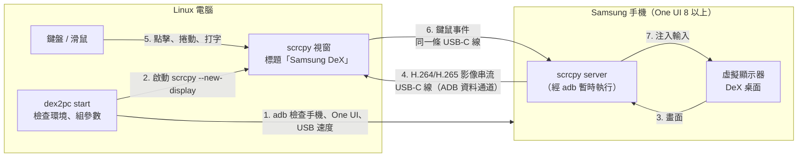

# dex2pc


**用一條 USB-C 線，把 Samsung DeX 變成 Linux 電腦上的一個視窗，並直接用電腦的鍵盤滑鼠操作。**

> 目前狀態：**測試版**，`start` 可一鍵開啟 DeX 視窗，`doctor` 可檢查電腦端工具、手機連線、USB 速度與 One UI 版本，`config` 可查看設定，`start --watch` 可在斷線後自動重連，`install-desktop` 可建立應用程式選單捷徑；
> 以上功能都**尚未在實機上驗收**，請照下方「[實機驗收清單](#實機驗收清單)」試用並回報。
> 版號只寫在 `Cargo.toml`，用 `dex2pc --version` 查看。

## 運作方式



1. **dex2pc** 經 adb 確認手機已授權、是 One UI 8 以上、USB 速度足夠
2. 檢查通過後啟動 **scrcpy**，在手機上建立**虛擬顯示器**，DeX 桌面跑在上面
3. 手機把畫面壓成**影片串流**，經 USB-C 線的資料通道傳回電腦，顯示成一個視窗
4. 在視窗裡的**鍵盤滑鼠操作**由 scrcpy 送回手機，所以用電腦的鍵鼠就能直接操作 DeX
5. **關閉視窗**就結束；`--watch` 時拔線後手機接回來會自動重新開啟

## 需求

- **電腦**：Fedora Linux（只支援 Linux）
- **手機**：Samsung，**One UI 8 以上**（DeX 改建在 Android 16 Desktop Mode 上，才能跑在虛擬顯示器）
- **adb**：`sudo dnf install android-tools`
- **scrcpy 3.0 以上**（需要 `--new-display`）：`sudo dnf copr enable zeno/scrcpy && sudo dnf install scrcpy`
- **支援資料傳輸的 USB-C 線**（有些線只能充電，接上後 `adb devices` 會看不到手機）
- 建置需要 Rust（cargo）

## 安裝

```bash
cargo install --path .     # 編譯並安裝到 ~/.cargo/bin/dex2pc
dex2pc install-desktop     # 選用：在應用程式選單加入「Samsung DeX」捷徑
```

`~/.cargo/bin` 要在 `PATH` 裡（用 rustup 安裝 Rust 時預設會加）。

**應用程式選單捷徑**：`dex2pc install-desktop` 會建立 `~/.local/share/applications/dex2pc.desktop`（依 `XDG_DATA_HOME`），點它等同執行 `dex2pc start`。

- 捷徑記錄的是**執行指令當下的 dex2pc 絕對路徑**，所以請在 `cargo install` 之後用 `dex2pc install-desktop` 建立，不要用 `cargo run`（會指向 `target/` 裡的檔案）
- 重複執行只會覆寫同一個檔案；移除用 **`dex2pc install-desktop --uninstall`**
- 捷徑沒有終端機，**看不到錯誤訊息**；點了沒反應時，在終端機跑 `dex2pc doctor` 看原因
- 捷徑不加 `--watch`：沒有終端機時，手機一直沒接回來會在背景一直等，使用者看不到也關不掉

## 快速開始

1. 手機開啟 **USB 偵錯**：設定 → 關於手機 → 軟體資訊 → 連點「版本號碼」7 次開啟開發人員選項，再到 設定 → 開發人員選項 → 開啟「USB 偵錯」
2. 用**支援資料傳輸的 USB-C 線**接上電腦，手機跳出「允許 USB 偵錯？」時按**允許**
3. 執行：

```bash
cargo run --release -- start
```

（已用 `cargo install --path .` 安裝時直接執行 **`dex2pc start`**。）

`start` 會先做和 `doctor` 一樣的檢查，全部通過才以虛擬顯示器開啟 **Samsung DeX** 視窗；直接用電腦的鍵盤滑鼠操作，**關閉視窗即結束**。
有問題時照畫面上的訊息處理，或先跑 `cargo run -- doctor` 看完整檢查結果。

```bash
cargo run -- start --dry-run               # 只印出會執行的 scrcpy 指令，不連手機
cargo run -- start --resolution 2560x1440 --video-bit-rate 16M   # 臨時覆寫設定檔
cargo run -- start --watch                 # 拔線或斷線後，手機接回來自動重新開啟視窗
```

**`--watch` 自動重連**：scrcpy 因手機斷線結束時，dex2pc 會等手機重新接上，再自動開啟視窗。

- **關閉視窗**或按 **Ctrl+C** 就結束，不會重連
- 斷線後**連續 5 次**重新啟動失敗就放棄，每次失敗後等 2 秒再試；重新連上一次就重新計數
- 第一次啟動就失敗時**不重試**，因為通常是設定或環境問題，重試也不會好

### 手機端需要另外設定嗎？

**不需要。** 只要開啟 USB 偵錯並允許這台電腦，dex2pc 不會改任何 `adb settings`。

已在實機確認（2026-10-10）：**Galaxy S23（SM-S9180）、One UI 8.5（Android 16）、scrcpy 5.0.1**，
`dex2pc start` 建立的 1920x1080/160 虛擬顯示器上直接跑起 DeX 的桌面
（`com.sec.android.app.launcher/com.honeyspace.dexservice.SecondaryLauncher`，有桌面圖示與工作列），
scrcpy 結束後虛擬顯示器也跟著移除。

> ⚠️ 其他機型若開出的視窗是空白或只有一般手機畫面、不是 DeX，
> 請回報手機型號與 One UI 版本，以及 `adb shell settings list global | grep -i -E 'desktop|freeform'` 的輸出。

## 建置與執行

```bash
cargo build --release
cargo run -- --help
cargo run -- --version
cargo run -- doctor     # 檢查 adb、scrcpy 是否就緒，手機是否已連接並授權、USB 速度、是否為 One UI 8 以上
cargo run -- doctor --serial R5CW1234ABC   # 連了多台手機時指定其中一台
cargo run -- config     # 顯示設定檔位置與實際生效的設定
cargo run -- config --path   # 只印設定檔位置
cargo run -- config --audio  # 預覽覆寫後的設定（設定檔 audio = false 時重新開啟音訊）
```

## 設定檔

位置：**`$XDG_CONFIG_HOME/dex2pc/config.toml`**（沒設 `XDG_CONFIG_HOME` 時是 `~/.config/dex2pc/config.toml`）。
檔案不存在就用內建預設值；每個欄位都可省略，CLI 參數（例如 `--resolution 3840x2160`）會覆寫設定檔。
音訊可用 `--audio` / `--no-audio` 雙向覆寫設定檔的 `audio`；兩個都給時以**最後一個**為準。

```toml
resolution = "1920x1080"   # 虛擬顯示器解析度
dpi = 160                  # 數字越大介面越大
video_bit_rate = "16M"     # 省略時用 scrcpy 預設（8M）；小字模糊時調高
audio = true               # false 時不轉送手機音訊
keyboard = "uhid"          # sdk、uhid、aoa、disabled；省略時用 uhid（sdk 在 DeX 上打不出字）
mouse = "sdk"              # 同上；省略時用 scrcpy 預設
window_title = "Samsung DeX"
```

欄位名稱打錯或型別不對時，dex2pc 會指出檔案路徑與欄位並結束，不會默默忽略。

開發時的檢查指令：

```bash
cargo fmt --check && cargo clippy --all-targets -- -D warnings && cargo test
```

**進版**：版號只改 `Cargo.toml` 的 `version`，README 的版本 badge **不要手改**，用下面的指令重新產生（忘了跑時 `cargo test` 會失敗並提示）：

```bash
cargo run --example sync_version_badge
```

## 實機驗收清單

以下項目**只能在實機上確認**，自動測試都是用假的 adb / scrcpy 輸出，沒有驗證過。試用後請回報哪些可以、哪些不行：

- [x] `dex2pc doctor` 正確列出手機型號、One UI 版本、USB 速度（Galaxy S23、One UI 8.5，2026-10-10）
- [x] `dex2pc start` 開出的虛擬顯示器是 **DeX 桌面**（同上，以 `adb screencap` 確認畫面內容）
- [x] **滑鼠**：點擊、右鍵、拖曳、滾輪捲動（2026-10-10；右鍵會傳給手機，**Shift+右鍵**是返回）
- [ ] **鍵盤**：英文輸入、快捷鍵、**中文輸入**（用電腦的輸入法打字能否送進手機）；2026-10-10 確認能打字，中文輸入與快捷鍵待確認
- [x] **剪貼簿**：電腦與手機之間複製貼上（2026-10-10）
- [x] **音訊**：手機的聲音從電腦播出（2026-10-10）；`--no-audio` 時不播
- [x] **拔線重連**：`dex2pc start --watch` 時拔掉再接回 USB 線，視窗會自動重新開啟（2026-10-10）
- [ ] **小字清晰度與操作延遲**：小字模糊時用 `--video-bit-rate 16M`（或更高）再試，回報是否改善
- [ ] 應用程式選單的「Samsung DeX」捷徑能開啟視窗

## 頻寬：USB 2.0 就夠嗎？

**夠。** 畫面是壓縮後的影片串流，不是原始畫面：

| 項目 | 需要 / 提供 |
|------|-------------|
| 不壓縮 1080p60 | 約 3 Gbps（所以一定要壓縮） |
| scrcpy 壓縮後影像（H.264/H.265） | 預設 **8 Mbps**，高畫質約 **16–20 Mbps** |
| 音訊 + 鍵鼠事件 | 不到 0.2 Mbps |
| USB 2.0 | 480 Mbps |

- 壓縮後的串流只用掉 USB 2.0 的一小部分，**瓶頸不在線材**，而在手機的硬體編碼器（解析度上限、發熱）與編解碼延遲（通常幾十毫秒）
- 小字模糊是壓縮造成的，**調高位元率**（`--video-bit-rate 16M`）通常就能改善
- `dex2pc doctor` 會顯示實際協商到的 USB 速度；低於 480 Mbps 才代表線材或 hub 有問題

## 原理：為什麼不是直接走 DisplayPort？

- 手機接外接螢幕時走的是 USB-C 的 **DisplayPort Alt Mode**，手機是**訊號來源**。
  電腦的 USB-C 孔同樣只會**輸出**影像，沒有接收端，兩個來源對接不會有畫面。
- 所以畫面改走 USB 的**資料通道**：手機把畫面壓成 H.264/H.265 影片串流，經 ADB 傳到電腦解碼成視窗，
  鍵鼠事件再經同一條線傳回手機。壓縮後只需約 8–20 Mbps，USB 2.0 就足夠。
  `doctor` 會顯示手機實際協商到的 USB 速度，低於 480 Mbps（USB 2.0）時警告可能是線材或 hub 的問題。

### scrcpy 是什麼？

[scrcpy](https://github.com/Genymobile/scrcpy) 是 Genymobile 開發的**開源免費**工具（Apache 2.0）。
它經 ADB 在手機上暫時跑一個小程式，負責畫面串流、在電腦上開視窗、轉送鍵鼠事件；
**不需要在手機裝 App，也不需要 root**。scrcpy 3.0 起的 `--new-display` 能在手機上建立虛擬顯示器，One UI 8 起 DeX 會直接跑在上面（已在實機確認，見上方「手機端需要另外設定嗎？」）。

dex2pc **不重寫**這些部分，只負責檢查環境、組好 scrcpy 參數、一鍵啟動。
